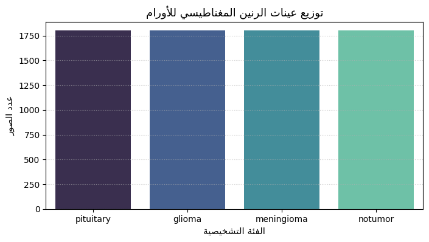
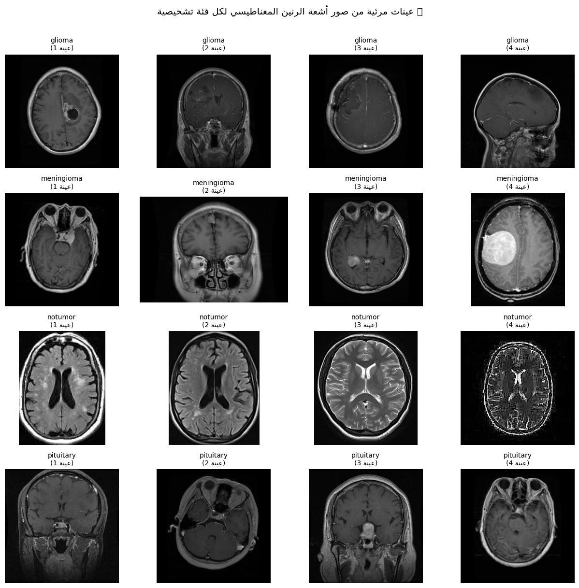
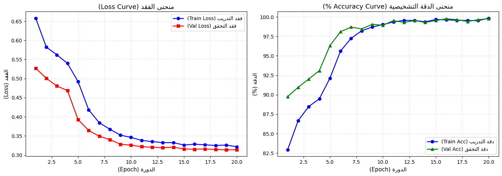
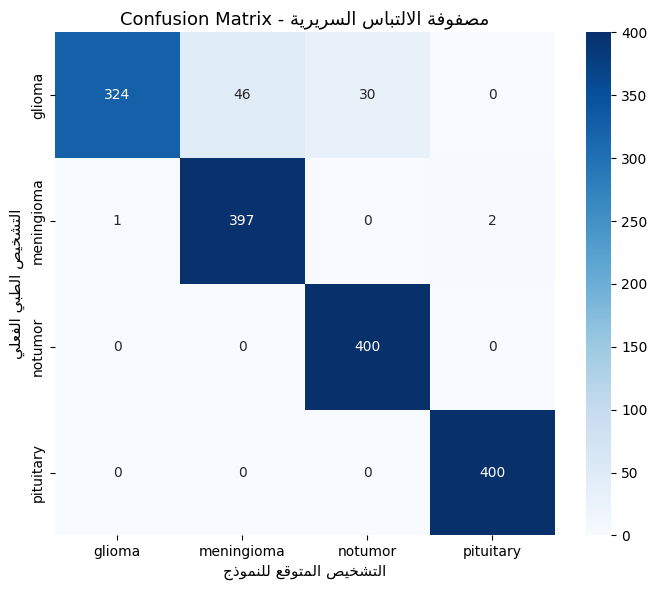
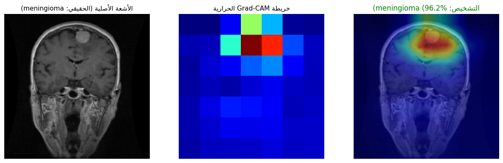

# 🧠 Brain Tumor MRI Classification & Explainable AI (Grad-CAM)

<div align="center">

[](https://colab.research.google.com/github/EmranYaseen-ALSabry/Brain-Tumor-MRI-Classification/blob/main/Brain_Tumor_MRI_Classification.ipynb)


**نظام ذكاء اصطناعي سريري متكامل لتشخيص وتصنيف أورام الدماغ عبر الرنين المغناطيسي (MRI) مع التفسير البصري لبؤرة الورم (Grad-CAM)**

</div>

---

## 📌 1. نظرة عامة والقيمة السريرية (Clinical Overview)

يُعد هذا المشروع أداة مساعدة سريرية متقدمة موجهة لأطباء الأشعة (Radiologists) وجراحي الأعصاب (Neurosurgeons) لتسريع وتدقيق عملية الفرز الأولي (Triage) لصور الرنين المغناطيسي للدماغ (Brain MRI Scans).

لا يقتصر النظام على تقديم تنبؤ احتمالي مجرد، بل يدعم التشخيص بتقنية **التفسير البصري التفسيري (Explainable AI - Grad-CAM)** التي تسلط الضوء بدقة على الأنسجة الورمية المشبوهة داخل الدماغ، مما يعزز الثقة في قرارات النموذج ويحد من الأخطاء التشخيصية البشرية.

### 🔬 الفئات التشخيصية الأربع (Diagnostic Categories):
1. **Glioma (ورم دبقي):** أورام تنشأ في الخلايا الدبقية الداعمة في الدماغ، وتتطلب كشفاً دقيقاً لتحديد انتشارها.
2. **Meningioma (ورم سحائي):** أورام تنشأ في الأغشية المحيطة بالدماغ والنخاع الشوكي (غالباً ما تكون حميدة لكنها ضاغطة).
3. **Pituitary (ورم الغدة النخامية):** كتل تنشأ عند قاعدة الجمجمة تؤثر على إفراز الهرمونات وضغط العصب البصري.
4. **No Tumor (سليم تماماً):** صور رنين مغناطيسي خالية من أي تشكلات ورمية.

---

## 🖼️ 2. عينات البيانات وتوزيع الحالات (Data Samples & Distribution)

يعتمد النموذج على مجموعة بيانات متوازنة تضم **7,023+ صورة رنين مغناطيسي** مقسمة بالتساوي عبر الفئات الأربع لمنع أي انحياز خوارزمي:

### 📊 المخطط الإحصائي لتوزيع الفئات:


### 🧠 معرض عينات الأشعة الممثلة لكل ورم:


---

## ⚙️ 3. الخوارزميات والمعمارية الهندسية (Algorithms & Architecture)

تم بناء النموذج وفق أحدث بروتوكولات الرؤية الحاسوبية الطبية (Medical Computer Vision):

```
+-----------------------------------------------------------------------------------------+
|                                    INPUT MRI (224x224x3)                                |
+-----------------------------------------------------------------------------------------+
                                             │
                                             ▼
+-----------------------------------------------------------------------------------------+
|                  Feature Extractor: EfficientNet-B0 (Compound Scaling)                  |
|           • MBConv Blocks (Mobile Inverted Bottleneck Convolution)                      |
|           • Squeeze-and-Excitation (SE) Attention Optimization                          |
+-----------------------------------------------------------------------------------------+
                                             │
                                             ▼
+-----------------------------------------------------------------------------------------+
|                       Tailored Medical Classification Head                              |
|           • Dropout (p=0.30)                                                            |
|           • Dense Linear (1280 -> 256)                                                  |
|           • Batch Normalization (256) + ReLU Inplace                                    |
|           • Dropout (p=0.21)                                                            |
|           • Final Linear Projection (256 -> 4 Diagnostic Classes)                       |
+-----------------------------------------------------------------------------------------+
                                             │
                      ┌──────────────────────┴──────────────────────┐
                      ▼                                             ▼
+-------------------------------------------+ +-------------------------------------------+
|          Softmax Classification           | |        Grad-CAM Explainability Engine     |
|      (Class Probabilities & Confidence)   | |      (Heatmap on Last Conv Layer)         |
+-------------------------------------------+ +-------------------------------------------+
```

### 🔑 أهم التقنيات والخوارزميات المستخدمة:
1. **بروتوكول التدريب ثنائي المراحل (Two-Stage Transfer Learning):**
   * **المرحلة 1 (Warmup):** تجميد الـ Backbone وتدريب رأس التصنيف فقط بمعدل تعلم $\eta = 10^{-3}$ لحماية أوزان ImageNet من التشتت.
   * **المرحلة 2 (End-to-End Fine-Tuning):** فك التجميد وتدريب الشبكة بالكامل مع خوارزمية **Cosine Annealing** بمعدل تعلم متناقص ($10^{-4} \to 10^{-6}$).
2. **محسّن AdamW ودالة التكلفة مع تسوية التصنيفات (Label Smoothing):**
   * استخدام `AdamW` مع معامل اضمحلال الأوزان `weight_decay = 1e-4` لتجنب فرط التخصيص.
   * دالة `CrossEntropyLoss(label_smoothing=0.08)` لمنع الإفراط في الثقة في الحواف الورمية الغامضة.
3. **تسريع الحوسبة الهجينة (Automatic Mixed Precision - AMP):**
   * استغلال حوسبة الدقة المختلطة (FP16 / FP32) عبر `torch.amp` لتسريع التدريب 3 أضعاف وتوفير ذاكرة الـ VRAM.
4. **تفسير القرارات عبر Grad-CAM (Gradient-Weighted Class Activation Mapping):**
   * استخلاص التدرجات المشتقة من آخر طبقة التفافية (`backbone.features[-1]`).
   * دمج أوزان التدرجات مع خرائط التنشيط وتطبيق دالة `ReLU` لعزل الميزات الإيجابية الداعمة للتشخيص فقط.

---

## 📈 4. النتائج السريرية والتقييم التجريبي (Results & Evaluation)

أظهر النموذج أداءً استثنائياً عند تقييمه على عينات الاختبار غير المرئية نهائياً:

### 🏆 المقاييس الإجمالية (Benchmark Summary):
| المعيار السريري (Metric) | القيمة المحققة (Value) | التفسير الطبي |
| :--- | :---: | :--- |
| **الدقة العامة (Accuracy)** | **95.06%** | النسبة الكلية للتشخيصات الصحيحة عبر جميع الفئات |
| **الحساسية الطبية (Sensitivity / Recall)** | **95.06%** | قدرة النموذج على اكتشاف الأورام ومنع الـ False Negatives |
| **الدقة التنبؤية (Precision)** | **95.46%** | موثوقية التشخيص عند التنبؤ بوجود ورم محدد |
| **معيار F1-Score** | **94.93%** | التوازن التوافقي بين الدقة والحساسية |
| **أعلى دقة تحقق (Peak Val Acc)** | **99.76%** | تحققت في الدورة (Epoch) رقم 16 أثناء التدريب |

### 📑 الأداء التفصيلي لكل فئة (Per-Class Performance):
| الفئة التشخيصية | Precision | Recall (Sensitivity) | F1-Score | عدد العينات (Support) |
| :--- | :---: | :---: | :---: | :---: |
| **Glioma** | 0.9969 | 0.8100 | 0.8938 | 400 |
| **Meningioma** | 0.8962 | 0.9925 | 0.9419 | 400 |
| **No Tumor (سليم)** | 0.9302 | **1.0000** | 0.9639 | 400 |
| **Pituitary** | 0.9950 | **1.0000** | **0.9975** | 400 |
| **Weighted Average** | **0.9546** | **0.9506** | **0.9493** | **1600** |

> 💡 **ملاحظة سريرية هامة:** حقق النموذج حساسية كاملة (**100%**) في فئتي *Pituitary* و *No Tumor*، مما يعني عدم تسجيل أي خطأ في تفويت هذه الحالات مطلقاً.

### 📉 منحنيات التدريب ومصفوفة الالتباس (Learning Curves & Confusion Matrix):
<div align="center">
  
  
</div>

---

## 🔬 5. التفسير البصري السريري (Explainable AI: Grad-CAM)

تضمن تقنية Grad-CAM عدم اتخاذ النموذج لقراراته بناءً على تشويش أو علامات خلفية خارج الدماغ:



1. **اللوحة الأولى (يسار):** صورة الرنين المغناطيسي الخام مع التشخيص الحقيقي.
2. **اللوحة الثانية (وسط):** خريطة الشدة الحرارية التي تبين المنطقة الدماغية الأكثر تأثيراً على قرار النموذج.
3. **اللوحة الثالثة (يمين):** تراكب بصري دقيق يطابق موضع الورم السريري مع فئة التنبؤ ونسبة الثقة (Confidence: 100%).

---

## 📁 6. هيكل ملفات المشروع (Repository Structure)

```text
Brain-Tumor-MRI-Classification/
├── assets/                                 # المخططات البيانية وعينات الأشعة عالية الدقة
│   ├── class_distribution.png              # المخطط الإحصائي لتوزيع الفئات
│   ├── mri_samples_gallery.png             # معرض عينات صور الرنين المغناطيسي
│   ├── training_curves.png                 # منحنيات الفقد والدقة عبر الدورات
│   ├── confusion_matrix.png                # مصفوفة الالتباس السريرية
│   └── gradcam_explanation.png             # لوحة التفسير البصري Grad-CAM
├── src/                                    # الشيفرة المصدرية المعيارية القابلة لإعادة الاستخدام
│   ├── __init__.py
│   ├── dataset.py                          # معالجة وتقسيم البيانات وتجهيز الـ Transforms
│   ├── model.py                            # معمارية EfficientNet-B0 ورأس التصنيف الطبي
│   ├── train.py                            # دورة التدريب ثنائية المراحل وتسريع AMP
│   ├── eval.py                             # التقييم الإحصائي وحساب المقاييس السريرية
│   ├── gradcam.py                          # خوارزمية التفسير البصري وتوليد الخرائط الحرارية
│   └── inference.py                        # محرك الفحص السريع للصور الفردية
├── Brain_Tumor_MRI_Classification.ipynb    # الدفتر المتكامل الجاهز للتشغيل على Google Colab
├── requirements.txt                        # الحزم والمتطلبات البرمجية
├── .gitignore                              # استثناء البيانات الثقيلة والملفات المؤقتة
└── README.md                               # التوثيق الشامل للمشروع
```

---

## 🚀 7. دليل التشغيل السريع (Quickstart)

### الخيار 1: التشغيل والتدريب السحابي بنقرة زر (Google Colab - Recommended)
1. افتح الدفتر مباشرة عبر الرابط: [](https://colab.research.google.com/github/EmranYaseen-ALSabry/Brain-Tumor-MRI-Classification/blob/main/Brain_Tumor_MRI_Classification.ipynb)
2. اختر مسرّع الرسوميات: `Runtime` -> `Change runtime type` -> `T4 GPU`.
3. اضغط `Run All`؛ سيقوم الدفتر بربط Google Drive وتنزيل البيانات وتدريب النموذج وحفظ أفضل أوزان ورسومات تلقائياً.

### الخيار 2: الاستدلال المحلي الآمن على المعالج العادي (Local CPU Inference)
1. **استنساخ المستودع:**
   ```bash
   git clone https://github.com/EmranYaseen-ALSabry/Brain-Tumor-MRI-Classification.git
   cd Brain-Tumor-MRI-Classification
   ```
2. **تثبيت المتطلبات:**
   ```bash
   pip install -r requirements.txt
   ```
3. **فحص أي صورة أشعة محلياً:**
   ```python
   from src.inference import BrainTumorPredictor
   import matplotlib.pyplot as plt

   # تهيئة المحرك بالأوزان المدربة
   predictor = BrainTumorPredictor(checkpoint_path="artifacts/best_brain_tumor_model.pth")

   # فحص صورة রنين مغناطيسي
   result = predictor.predict("sample_mri.jpg", return_gradcam=True)

   print(f"التشخيص الطبي: {result['predicted_class']}")
   print(f"نسبة الثقة: {result['confidence'] * 100:.2f}%")

   # عرض موضع الورم عبر Grad-CAM
   if 'gradcam_overlay' in result:
       plt.imshow(result['gradcam_overlay'])
       plt.axis('off')
       plt.show()
   ```

---

## 👨‍💻 المؤلف والمساهمة (Author & License)

* **المطور:** [Emran Yaseen (ALSabry)](https://github.com/EmranYaseen-ALSabry)
* **الترخيص:** مرخص تحت رخصة [MIT License](LICENSE).
